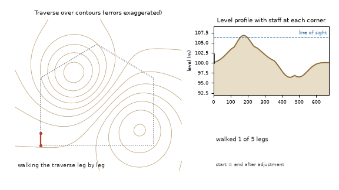
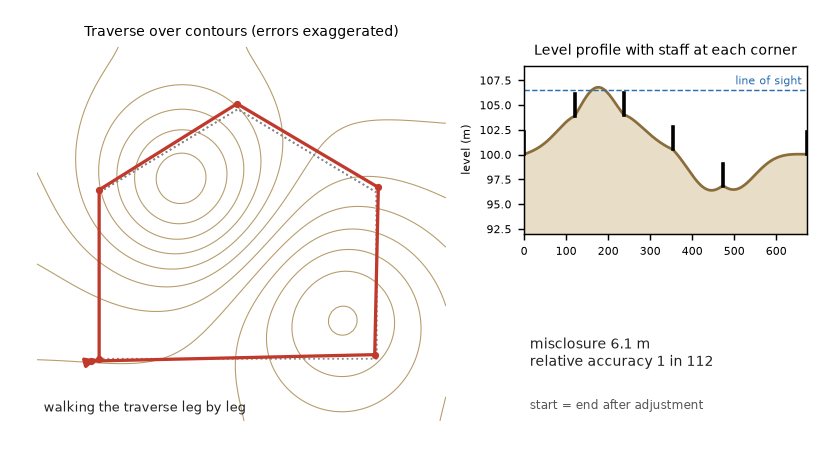
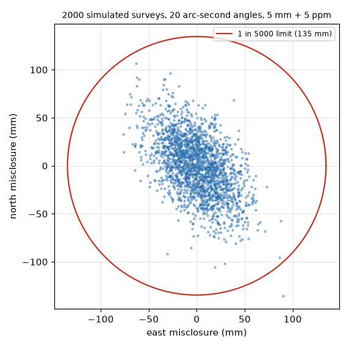

# What you are building toward

A surveyor walks a five-corner plot leg by leg over a contour map. At the end the walk misses its start: a red misclosure arrow appears (errors are exaggerated so you can see it). Then the Bowditch correction slides every corner back along the walk until the figure closes, while a levelling profile below shows the staff readings for the same ground. Your goal over the coming sessions: build that adjustment and the contour and level profile yourself, then extend them.

*Target: a traverse walked leg by leg, the misclosure arrow, and the Bowditch correction closing it*

*Target still: the unadjusted walk (red) and the adjusted corners (green) over a contour map, with a level profile*

*Where 2000 simulated surveys end: the scatter of misclosure vectors with typical instrument errors*

These results come from a private reference build. The code is not published; the roadmap shows the path so you can build your own.

Live links:

- [Math Visual Studio: coordinates and analytic geometry (Atlas S05)](https://krunalpanchal1995.github.io/studio/#atlas?ch=S05&ex=1)
