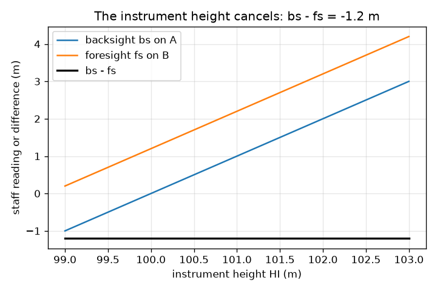
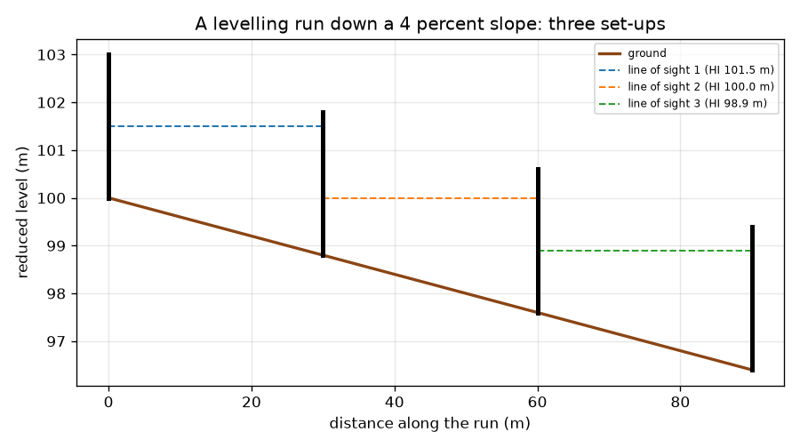

# Session 1: Height difference with a level and a staff

*Level 1 (conceptual interactive model) · about 60 minutes · opensurvey*

> This is a simplified educational model. It is not a validated design tool and must not be used for real structures, electrical installations, vehicles, industrial processes or medical decisions.

**Prerequisites**

- Subtracting decimals.
- You have read PRIMER.md and run `python start.py 1` once.

**Learning objectives.** After this session you can:

- Explain what a level and a staff measure.
- Compute the rise or fall between two points as backsight minus foresight, and the reduced level of the new point.
- Chain several set-ups into a levelling run down a slope.
- Show that the height of the instrument does not matter, and measure a distance by pacing.

## A. Real-world problem
Before a road, a drain or a building platform is built, someone must know how much higher or lower one point is than another. Water only runs downhill, so a drain that slopes the wrong way does not work. You cannot tell by eye. A surveyor uses a level (a telescope that stays exactly horizontal) and a staff (a tall ruler held upright) and subtracts two readings. How can two readings, taken from a spot that is neither point, give the height difference between them?

## B. Concept and theory
The level is set up between two points A and B. Its line of sight is perfectly horizontal at some height above the datum (the reference height, such as sea level). The staff is held upright on A and read through the telescope: that is the backsight, bs. Then the staff is moved to B: that is the foresight, fs. A large reading means the ground is low, because most of the staff is then below the line of sight. So the rise from A to B is bs - fs (a negative answer is a fall), and the reduced level (RL, the height above the datum) of B is the RL of A plus that rise. If B is too far for one set-up, the surveyor leaves the staff on a turning point and moves the level on. Distance can be found roughly by pacing: walk a known distance, count paces, and use distance = paces x pace length.

| Symbol | Meaning | Unit |
|---|---|---|
| bs | backsight: staff reading on the point behind (the known point) | m |
| fs | foresight: staff reading on the point ahead | m |
| RL | reduced level: height above the chosen datum | m |
| HI | height of the line of sight (collimation height) | m |
| pace length | average length of one pace, from a calibration walk | m |

**Assumptions**

- The line of sight is exactly horizontal.
- The staff is held upright and read exactly.
- Sights are short, so the Earth's curvature can be ignored (Session 3 shows when it cannot).
- Pacing is a rough method; a tape or a total station is better.

$$ \text{rise from A to B}=bs-fs,\qquad RL_B=RL_A+(bs-fs) $$

$$ bs=HI-RL_A,\quad fs=HI-RL_B\ \Rightarrow\ bs-fs=RL_B-RL_A\ \text{(HI cancels)} $$

$$ \text{distance}=\text{paces}\times\text{pace length} $$

## C. Visual explanation
The first figure shows a levelling run down a 4 percent slope: the ground, three dashed lines of sight (one per set-up) and the staffs. Each set-up reads a backsight and a foresight and finds a fall of 1.2 m, so over 90 m the ground falls 3.6 m and B ends at 96.4 m. The second figure plots the two readings and their difference against the instrument height: the readings change with it, the difference stays at -1.2 m. That flat line is why the level may stand anywhere between the staffs.

*Backsight and foresight change with the instrument height; their difference does not.*

*A levelling run down a 4 percent slope: three set-ups, three lines of sight.*

## D. Interactive simulation
Run the lesson (`python start.py 1`), then open the live app: [Session 1: a level and two staffs](https://krunalpanchal1995.github.io/opensurvey/session-01/) (or `app.html` in this folder). Move the slope and distance sliders and watch the foresight grow, then switch to the level view and see the ground fall. Change the backsight and see that the fall does not change.

**Challenge.** Make point B end at a reduced level of 98.4 m (A is 100.0 m).

## E. Worked example and experiment
**Problem.** A benchmark A has RL 100.000 m. The backsight on A is 1.525 m and the foresight on B is 2.310 m. Find the rise or fall and the RL of B.

1. Rise = bs - fs = 1.525 - 2.310 = -0.785 m.
2. The negative sign means a fall: B is 0.785 m lower than A.
3. RL of B = 100.000 + (-0.785) = 99.215 m.
4. Sanity check: the foresight is bigger than the backsight, so the staff on B is lower in the line of sight, so B is the lower point. The answer is consistent.

**Answer.** B is 0.785 m lower than A, at RL 99.215 m.

**Experiment.** With a builder's level (or a clear water-filled hose) and a metre rule, take bs and fs between two points in a school corridor or garden, 10 m apart, and compute the difference. Then move the level to another spot and repeat: you should get the same difference to a few millimetres. Differences come from reading the rule, from the level not being exactly horizontal and from the staff leaning; the model assumes perfect readings.

## F. Assessment and design challenge
**Question type A: Conceptual.** Why does the answer bs - fs not depend on how high the level is above the ground?

Hint

Write each reading as the height of the line of sight minus the height of the ground.

Step-by-step solution

bs = HI - RL_A and fs = HI - RL_B, so bs - fs = RL_B - RL_A: HI cancels. If the instrument is raised by 0.40 m, both readings drop by 0.40 m and the difference is unchanged (-1.2 m in the run of the lesson). That is why the level can stand anywhere between the two staffs.

**Question type B: Numerical.** The backsight on a point of RL 54.320 m is 0.872 m and the foresight on the next point is 2.134 m. Find the RL of the next point and say whether the ground rises or falls.

Hint

Rise = bs - fs, then add to the RL.

Step-by-step solution

Rise = 0.872 - 2.134 = -1.262 m, a fall. RL = 54.320 - 1.262 = 53.058 m. Sanity check: the foresight is bigger, so the new point is lower. Units: metres.

**Question type C: Graph and simulation interpretation.** From the levelling-run figure, what is the grade (slope in percent) of the ground, and how much does it fall per set-up?

Hint

Grade = fall divided by horizontal distance, times 100.

Step-by-step solution

The ground falls 3.6 m over 90 m, so the grade is 3.6 / 90 x 100 = 4 percent. Each of the three set-ups covers 30 m and falls 1.2 m, the same each time because the slope is uniform.

**Question type D: Design and optimisation challenge.** Design: the staff is 4.0 m long, the ground falls 5 percent from the backsight staff, and the backsight reads 1.0 m. How far away can the foresight staff stand so that the reading is still on the staff? Why not simply use very short sights?

Hint

The foresight is the backsight plus the fall over the distance.

Step-by-step solution

fs = 1.0 + 0.05 x d must stay at or below 4.0 m, so d is at most 60 m. Very short sights need more set-ups for the same line, so more readings, more time and more chances for small errors to add up (Session 2 shows how fast). A good plan uses the longest sights that stay on the staff and within the telescope's reliable range, and keeps backsight and foresight lengths about equal.

Score yourself with [RUBRIC.md](../../RUBRIC.md). Print the [activity sheet](activity_sheet.md) to work on paper.

## Common misconceptions
| Common misconception | What is actually true |
|---|---|
| A bigger staff reading means a higher point. | A bigger reading means a lower point: more of the staff is below the line of sight. |
| The level must stand on the line between A and B at the same height as the points. | It can stand anywhere with both staffs in view, at any height, because the instrument height cancels in bs - fs. |
| Rise is foresight minus backsight. | Rise is backsight minus foresight. Check with the sign: a bigger foresight must give a negative rise (a fall). |
| Pacing is as accurate as a tape. | Pacing depends on your pace, the ground and your tiredness. It is a quick check, not a measurement for setting out a building. |

## Glossary
- **level**: a telescope mounted so its line of sight stays horizontal
- **staff**: a tall upright ruler read through the level
- **backsight (bs)**: the staff reading on the known point behind
- **foresight (fs)**: the staff reading on the new point ahead
- **reduced level (RL)**: the height of a point above a chosen datum
- **datum**: the reference height from which levels are measured
- **turning point**: a point where the staff stays while the level is moved on

## Finish
1. Do the three coding tasks in [exercises.md](exercises.md).
2. Run `python start.py 1` again after your changes. It ends with the checkpoint; when it prints `PASS`, you are done. (Checkpoint only: `python start.py check 1`.)

Next: [Session 2](../session-02/README.md)
