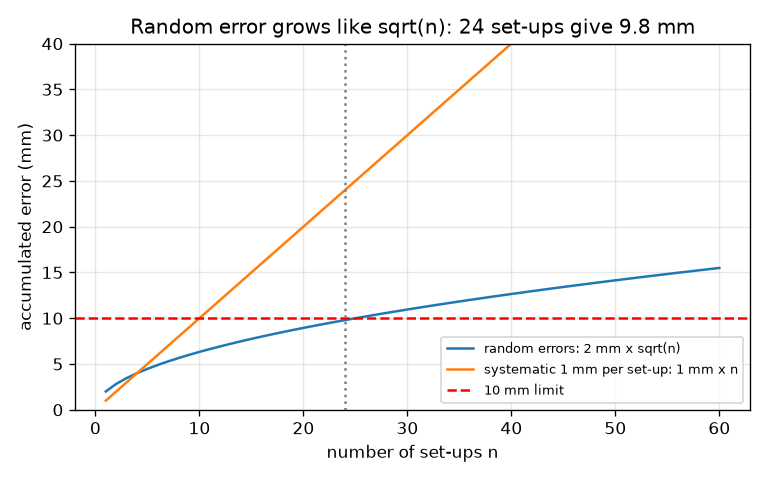
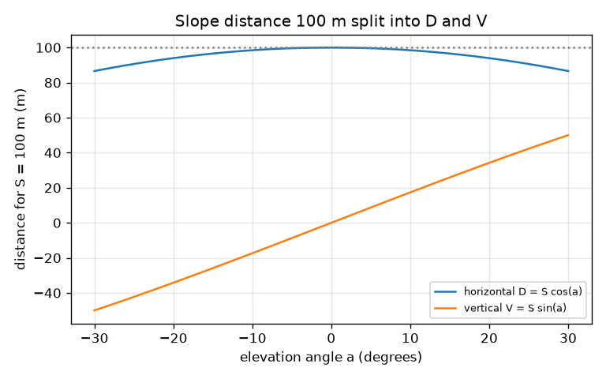

# Session 2: Levelling books, slope distances and total-station coordinates

*Level 2 (mathematical engineering model) · about 75 minutes · opensurvey*

> This is a simplified educational model. It is not a validated design tool and must not be used for real structures, electrical installations, vehicles, industrial processes or medical decisions.

**Prerequisites**

- Session 1: backsight, foresight and reduced level.
- Sine and cosine of an angle.

**Learning objectives.** After this session you can:

- Reduce a levelling book by the height-of-instrument method and by the rise-and-fall method.
- Apply the arithmetic check and explain what it cannot find.
- Convert a slope distance and angle to horizontal distance, and bearing and distance to easting and northing.
- Use the square-root law to choose how far apart the staff positions can be.

## A. Real-world problem
A real levelling run is written in a table, the levelling book, and a single wrong subtraction spoils every level after it. A total station, the instrument that has replaced the theodolite and tape on many sites, measures a slope distance and angles, and a computer must turn those into coordinates on a map. And a practical question: over 1 km of levelling, how far apart can the staffs stand if small random reading errors of 2 mm per set-up must add up to less than 10 mm?

## B. Concept and theory
In a levelling book each row is a backsight (BS), an intermediate sight (IS) or a foresight (FS). A foresight followed by a backsight is a change point: the same point seen from two set-ups. Height of instrument method: at each set-up, HI = RL of the backsight point + BS, and every other point has RL = HI - reading. Rise and fall method: compare each reading with the one before it in the same set-up; rise = previous - current; RL = previous RL + rise. Both must give the same levels. The arithmetic check says: sum of backsights - sum of foresights = last RL - first RL. It checks the arithmetic of the chain, not the readings, and it cannot see a wrong intermediate sight. For a total station, the slope distance S and the elevation angle a give the horizontal distance D = S cos a and the height change V = S sin a. From a station at (E0, N0), with the bearing measured clockwise from north, a point at horizontal distance D is at E = E0 + D sin(bearing) and N = N0 + D cos(bearing). Finally, random errors do not add up in a straight line: if each of n set-ups adds an independent error with standard deviation s, the total has standard deviation s sqrt(n).

| Symbol | Meaning | Unit |
|---|---|---|
| BS, IS, FS | backsight, intermediate sight, foresight readings | m |
| HI | height of instrument (collimation height) | m |
| S | slope distance measured by the total station | m |
| a | elevation angle above the horizontal | degrees |
| D, V | horizontal distance and height change | m |
| bearing | direction, clockwise from grid north | degrees |
| E, N | easting and northing (grid coordinates) | m |
| s | standard deviation of the error of one set-up | mm |
| n | number of set-ups | no unit |

**Assumptions**

- Readings are to the nearest millimetre and the line of sight is horizontal.
- The errors of different set-ups are random and independent, with the same s (a simplification; a systematic error such as a tilted line of sight adds up like n instead).
- The grid is flat over the small area (no map projection effects).
- The total station is set up over a known point with a known direction.

$$ HI=RL_{\text{back}}+BS,\qquad RL=HI-\text{reading} $$

$$ \text{rise}=\text{previous reading}-\text{current reading},\qquad RL=RL_{\text{previous}}+\text{rise} $$

$$ \sum BS-\sum FS=RL_{\text{last}}-RL_{\text{first}} $$

$$ D=S\cos a,\qquad V=S\sin a $$

$$ E=E_0+D\sin\beta,\qquad N=N_0+D\cos\beta $$

$$ \sigma_n=s\sqrt{n},\qquad n<\left(\dfrac{\text{limit}}{s}\right)^2 $$

## C. Visual explanation
The first figure plots accumulated error against the number of set-ups. The random-error curve 2 mm x sqrt(n) climbs slowly and reaches 9.8 mm at 24 set-ups, just under the red 10 mm line. A systematic error of only 1 mm per set-up climbs as a straight line and is already 24 mm at 24 set-ups. The second figure splits a 100 m slope distance into horizontal and vertical parts as the angle changes: D = S cos a is flat near 0 degrees and falls slowly, V = S sin a rises almost linearly.

*Random error grows like sqrt(n); a systematic error grows like n.*

*A 100 m slope distance split into horizontal and vertical parts.*

## D. Interactive simulation
Run the lesson (`python start.py 2`), then open the live app: [Session 2: a total station shot](https://krunalpanchal1995.github.io/opensurvey/session-02/) (or `app.html` in this folder). Move the slope distance, angle and bearing sliders. Watch the point move in the plan view and see D and V in the graph view. Check that E and N in the readout follow E = 1000 + D sin(bearing), N = 5000 + D cos(bearing).

**Challenge.** Place the point due east of the station, 100 m away horizontally (within 0.5 m), by choosing the slope distance and the angle.

## E. Worked example and experiment
**Problem.** Reduce the levelling book of the lesson (BS 1.425 on a benchmark of RL 100.000, IS 1.870, IS 2.315, FS 2.905, then BS 1.150, IS 0.980, FS 0.640). Then a total station at E 1000.000, N 5000.000, RL 50.000, with instrument height 1.55 m, measures a prism (height 1.80 m) at slope distance 85.340 m, elevation angle 7.5 degrees, bearing 63.5 degrees. Find the coordinates and the RL.

1. First set-up: HI = 100.000 + 1.425 = 101.425 m. Levels: 101.425 - 1.870 = 99.555, 101.425 - 2.315 = 99.110, 101.425 - 2.905 = 98.520 m (the change point).
2. Second set-up: HI = 98.520 + 1.150 = 99.670 m. Levels: 99.670 - 0.980 = 98.690 and 99.670 - 0.640 = 99.030 m.
3. Rise and fall gives the same: the first intermediate sight is a fall of 1.425 - 1.870 = -0.445 m, and so on.
4. Arithmetic check: sum BS = 2.575, sum FS = 3.545, difference -0.970. Last RL - first RL = 99.030 - 100.000 = -0.970. They agree.
5. Total station: D = 85.340 cos 7.5 degrees = 84.610 m and V = 85.340 sin 7.5 degrees = 11.139 m (use the program for the digits).
6. E = 1000 + 84.610 sin 63.5 degrees = 1075.720 and N = 5000 + 84.610 cos 63.5 degrees = 5037.753.
7. RL of the ground at the prism = 50.000 + 1.55 + V - 1.80 = 60.889 m.

**Answer.** Levels 99.555, 99.110, 98.520, 98.690 and 99.030 m (check passed); the point is at E 1075.720, N 5037.753, RL 60.889 m, and the inverse from the station returns bearing 63.5 degrees and distance 84.610 m.

**Experiment.** Mark two points about 10 m apart on a football field or school ground, measure the slope distance with a tape along the ground, and the angle with a phone clinometer app held on a straight stick. Compute D = S cos a and compare with a second measurement made with the tape held horizontal in steps (plumb-bob method). Differences of several centimetres are normal: the model assumes a straight, taut tape and an exact angle, the field has sag, wind and a phone with an error of a degree or so.

## F. Assessment and design challenge
**Question type A: Conceptual.** A student adds a misread intermediate sight (0.100 m too big) to the levelling book and finds the arithmetic check still passes. Is the check useless? What does it prove and what does it not?

Hint

Which readings feed the last RL?

Step-by-step solution

The check compares sum BS - sum FS with the last RL minus the first RL. Intermediate sights appear in neither, so a wrong IS leaves the check passing while that point's own level is wrong by 0.100 m. The check proves the reductions along the backsight and foresight chain were done without an arithmetic slip (a slip of 0.010 m in the last level would break it). It does not prove that the readings were read or booked correctly. Intermediate sights need a different check, such as a closing line or a second reading.

**Question type B: Numerical.** A tape along a slope reads S = 120.50 m at an elevation angle of 12 degrees. Find D and V. Then, from E 1000, N 5000, find the point 50 m away at bearing 245 degrees.

Hint

D = S cos a, V = S sin a; then E = E0 + D sin(bearing), N = N0 + D cos(bearing).

Step-by-step solution

D = 120.50 cos 12 = 117.87 m and V = 120.50 sin 12 = 25.05 m. Sanity check: D is a little less than S and V is about 0.2 of S, which fits 12 degrees. For the point: E = 1000 + 50 sin 245 = 954.68 and N = 5000 + 50 cos 245 = 4978.87 (south-west of the station, which is right for 245 degrees). Units: metres.

**Question type C: Graph and simulation interpretation.** In the graph of D and V against the angle for S = 100 m, how much shorter than S is D at 10 degrees and at 25 degrees? What does this say about when you can ignore the slope?

Hint

Compute 1 - cos a for each angle.

Step-by-step solution

D is S cos a, so the shortening is 1 - cos a: 1.5 percent at 10 degrees (1.5 m in 100 m) and 9.4 percent at 25 degrees. On gentle slopes the correction is small but it is never zero; for work to a few millimetres per 100 m it must always be applied. The curve is flat near 0 degrees because the cosine is flat there.

**Question type D: Design and optimisation challenge.** Design: a 4 km levelling line must have a random error below 10 mm, and each set-up has s = 1.5 mm. How many set-ups at most, and what spacing is that? Choose a practical spacing of whole tens of metres and give the resulting error. Mention one other limit on the spacing.

Hint

n < (limit / s)^2, spacing = length / n.

Step-by-step solution

n < (10 / 1.5)^2 = 44.4, so at most 44 set-ups: the spacing must be at least 4000 / 44 = 90.9 m. A practical choice is 100 m, which means 40 set-ups and an error of 1.5 x sqrt(40) = 9.49 mm, inside the limit. The other limit is the other direction: the staff must still be readable and the line of sight must not be too close to the ground, so very long sights are not allowed, and curvature and refraction (Session 3) grow as the square of the sight length. Trade-off: fewer, longer set-ups are faster and accumulate less random error but are limited by visibility and by the Earth's curvature.

Score yourself with [RUBRIC.md](../../RUBRIC.md). Print the [activity sheet](activity_sheet.md) to work on paper.

## Common misconceptions
| Common misconception | What is actually true |
|---|---|
| If the arithmetic check passes, the levelling is right. | It only proves the arithmetic. A misread reading, especially an intermediate sight, passes the check. |
| Errors double when the line doubles in length. | Random errors grow like the square root: doubling the number of set-ups multiplies the error by about 1.4. Systematic errors do grow in proportion. |
| Bearing 90 degrees goes with the cosine. | The bearing is measured from north, so east uses sin and north uses cos: E = E0 + D sin(bearing), N = N0 + D cos(bearing). |
| The slope distance can be plotted on the map. | A map is flat: it needs the horizontal distance D = S cos a. |

## Glossary
- **levelling book**: the table in which readings and reduced levels are written
- **height of instrument**: the height of the line of sight, RL of the backsight point plus the backsight
- **change point**: a point that is a foresight of one set-up and a backsight of the next
- **bearing**: direction measured clockwise from north, 0 to 360 degrees
- **easting, northing**: the east and north coordinates of a point on the grid
- **total station**: an instrument that measures angles and distances electronically
- **standard deviation**: a measure of how widely repeated measurements scatter

## Finish
1. Do the three coding tasks in [exercises.md](exercises.md).
2. Run `python start.py 2` again after your changes. It ends with the checkpoint; when it prints `PASS`, you are done. (Checkpoint only: `python start.py check 2`.)

Next: [Session 3](../session-03/README.md)
