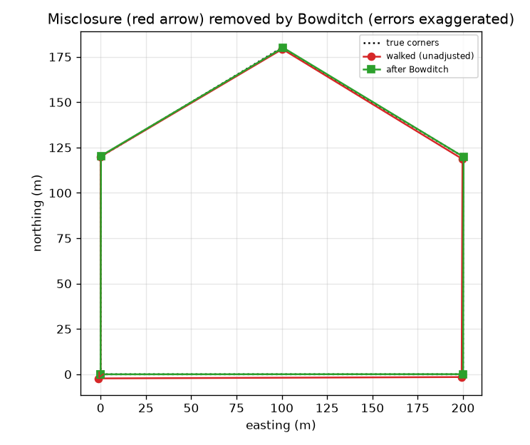
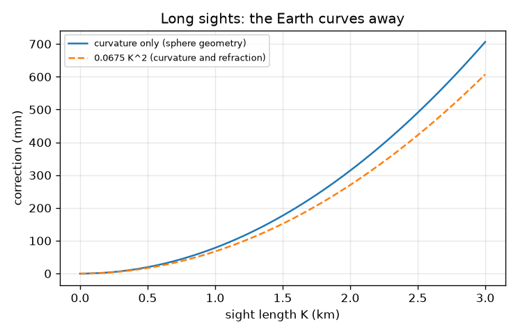
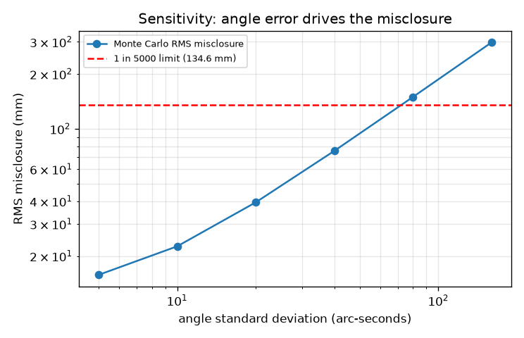

# Session 3: Close, adjust and test a traverse

*Level 3 (simulation and validation) · about 90 minutes · opensurvey*

> This is a simplified educational model. It is not a validated design tool and must not be used for real structures, electrical installations, vehicles, industrial processes or medical decisions.

**Prerequisites**

- Session 2: bearing and distance to easting and northing.
- Standard deviation as the typical size of a random error.

**Learning objectives.** After this session you can:

- Compute the misclosure of a closed traverse and judge it by the relative accuracy and the angle check.
- Apply and verify the Bowditch rule, and find the area by the coordinate (shoelace) method.
- Propagate typical angle and distance errors by seeded Monte Carlo and check the result against a first-order prediction and the exact polygon.
- Recognise a blunder that adjustment hides, and locate it.

## A. Real-world problem
To fix the corners of a plot, a surveyor walks round it: the angle at each corner and the length of each side are measured. Because every measurement has a small error, the walk does not quite end where it began. How big is that gap, is it acceptable, and how should it be spread over the corners? And the nasty case: what if one angle is simply read wrongly, and the tidy adjustment makes the figure close perfectly anyway?

## B. Concept and theory
A closed traverse has n corners. From the bearing of the first leg and the interior angles (walking clockwise), each next bearing is the previous bearing + 180 - interior angle. Each leg of length D and bearing b contributes a departure dE = D sin b and a latitude dN = D cos b. For a perfect traverse, the sum of all departures and the sum of all latitudes are zero. In practice their sums (eE, eN) are the misclosure vector; its length is the misclosure. The relative accuracy is perimeter / misclosure, written 1 in N (1 in 5000 is a commonly used target for ordinary work). The interior angles of an n-sided polygon sum to (n - 2) x 180 degrees: any difference is the angular misclosure, shared equally between the angles first. The Bowditch (compass) rule then gives leg i a correction proportional to its length: cE_i = -eE D_i / P and cN_i = -eN D_i / P, where P is the perimeter. These corrections sum to exactly -e, so the adjusted traverse closes exactly. The area follows from the corner coordinates by the shoelace formula. Errors are studied by simulation: add random errors to a known polygon (typical figures for a mid-range total station: 20 arc-seconds per angle, and 5 mm + 5 ppm per distance), adjust, and compare with the exact answer, many times. For long sights, the Earth's curvature and the bending of light matter: the combined correction to a staff reading is about 0.0675 K^2 metres for a sight of K kilometres.

| Symbol | Meaning | Unit |
|---|---|---|
| D, b | leg length and bearing | m, degrees |
| dE, dN | departure and latitude of a leg | m |
| eE, eN | misclosure vector (sum of departures, sum of latitudes) | m |
| P | perimeter (sum of leg lengths) | m |
| 1 in N | relative accuracy, N = P / misclosure | no unit |
| sigma | standard deviation of a measurement (typical: 20 arc-seconds; 5 mm + 5 ppm) | arc-seconds, mm |
| K | length of a long sight | km |
| k | coefficient of refraction (typical 0.14) | no unit |
| R | radius of the Earth, 6371 km | km |

**Assumptions**

- The traverse is walked clockwise round a flat plot with the interior angles measured; the first bearing is known without error.
- Angle and distance errors are random, independent and have the stated typical standard deviations (they are not the figures of any one instrument; check a datasheet).
- Bowditch is a simple rule, not the best statistical adjustment (least squares is better; see the roadmap).
- Curvature uses a spherical Earth of radius 6371 km; refraction varies with the weather and 0.14 is only a typical value.
- All data are synthetic; this is education and not a method to rely on for legal boundaries or setting-out.

$$ b_{i}=b_{i-1}+180^\circ-\theta_i,\qquad dE_i=D_i\sin b_i,\quad dN_i=D_i\cos b_i $$

$$ e_E=\sum dE_i,\quad e_N=\sum dN_i,\quad e=\sqrt{e_E^2+e_N^2},\quad \text{1 in }N,\ N=P/e $$

$$ \sum\theta_i=(n-2)\times180^\circ $$

$$ c_{E,i}=-e_E\,\frac{D_i}{P},\quad c_{N,i}=-e_N\,\frac{D_i}{P},\quad \sum_i(dE_i+c_{E,i})=0 $$

$$ A=\tfrac12\left|\sum_i\left(E_iN_{i+1}-E_{i+1}N_i\right)\right| $$

$$ c\approx\frac{(1-k)K^2}{2R}\approx0.0675\,K^2\ \text{m} $$

## C. Visual explanation
The first figure shows a walked traverse with exaggerated errors: the red path fails to return to the start (the red arrow is the misclosure) and the green path, after Bowditch, closes. The second figure plots the root-mean-square misclosure from the simulation against the angle error. It rises from 16 mm at 5 arc-seconds to 298 mm at 160 arc-seconds (nearly in proportion once the angle error is above about 40 arc-seconds), and crosses the red limit for 1 in 5000 (134.6 mm for this plot) between 40 and 80 arc-seconds. The third figure compares the curvature alone from the sphere geometry with the combined formula 0.0675 K^2.

*A walked traverse with exaggerated errors: misclosure (red arrow) and the Bowditch-adjusted closed figure (green).*

*Curvature of the Earth (sphere geometry) and the combined curvature and refraction formula.*

*Root-mean-square misclosure against angle error: it rises in proportion and crosses the 1 in 5000 limit.*

## D. Interactive simulation
Run the lesson (`python start.py 3`), then open the live app: [Session 3: a closed traverse with errors](https://krunalpanchal1995.github.io/opensurvey/session-03/) (or `app.html` in this folder). Move the angle error and distance error sliders and watch the red walk drift away from the dotted true plot and the misclosure arrow grow. Open the graph view to see the misclosure against the limit. Then add the blunder and see the misclosure jump while the green adjusted figure still closes.

**Challenge.** With a distance error of 10 mm and no blunder, find the largest angle error scale (a multiple of 20 arc-seconds) that still gives a relative accuracy of at least 1 in 5000.

## E. Worked example and experiment
**Problem.** A traverse of perimeter 673.238 m has a misclosure vector (eE, eN) = (+0.100, -0.060) m. Find the misclosure, the relative accuracy, and the Bowditch correction for the 200 m leg. Is 1 in 5000 met?

1. Misclosure = sqrt(0.100^2 + 0.060^2) = 0.1166 m.
2. Relative accuracy = 673.238 / 0.1166 = 5773, so 1 in 5773.
3. The 200 m leg gets cE = -0.100 x 200 / 673.238 = -0.0297 m and cN = +0.060 x 200 / 673.238 = +0.0178 m.
4. 1 in 5773 is better than 1 in 5000, so the traverse is acceptable and may be adjusted.
5. The five corrections for all legs sum to (-0.100, +0.060), the opposite of the misclosure, so the adjusted traverse closes exactly (the checkpoint verifies this on a simulated survey).
6. Area check on the exact plot (rectangle 200 m x 120 m plus a gable of base 200 m and height 60 m): 24000 + 6000 = 30000 m2, and the shoelace formula gives the same.

**Answer.** Misclosure 0.1166 m, relative accuracy 1 in 5773 (acceptable); the 200 m leg is corrected by (-0.0297, +0.0178) m; the plot area is 30000 m2.

**Experiment.** Pace out or tape a small four-sided plot in a playground, measure the four sides and the four angles with a phone clinometer or a school protractor, and compute the angle sum and the closure of the walk. Expect an angular misclosure of a degree or so and a relative accuracy far worse than 1 in 5000. The model of this session assumes an instrument good to seconds of arc and millimetres; your equipment is much rougher, which is the reason surveyors use total stations.

## Real-world application and mini-project: Adjust a field traverse and report coordinates and area
A crew hands you the synthetic field book of a six-corner site, walked clockwise from corner 1 at E 5000.000, N 10000.000 m (`FIELD_START`, `FIELD_B0`, `FIELD_ANGLES`, `FIELD_DISTS` in Session 3). The angles do not add up: one of them was misread. Run the angle check and the adjustment as given, find the corner with the blunder using `locate_angle_blunder`, correct that angle, adjust again, and report the final corner coordinates and the area.

**Deliverable:** A script that prints, before and after the correction, the angle misclosure, the linear misclosure and the relative accuracy; names the corner with the blunder; prints the six adjusted coordinates to the nearest millimetre and the area in square metres; and saves a picture of the adjusted traverse.

**Success looks like:** As given, the angle sum is about 1.007 degrees off and the closure is only 1 in 332. You name corner 4 and a blunder of about 1.0 degree. After the correction the angle misclosure is about 26 arc-seconds, the closure is about 1 in 20180, the area is 53300.35 m2 (the exact area of the answer key is 53300 m2) and every corner is within 0.04 m of FIELD_TRUTH.

## F. Assessment and design challenge
**Question type A: Conceptual.** The Bowditch rule always makes a traverse close exactly. Does a perfect closure after adjustment prove that the survey is correct? Give an example from this session.

Hint

Think about what the rule does to a blunder.

Step-by-step solution

No. The rule forces the figure to close whatever the cause of the gap. In the lesson, one interior angle is read 1 degree too big. The raw misclosure is 4.071 m, and after spreading the angle error the misclosure is 1.851 m (1 in 364), yet after Bowditch the figure closes to better than 1e-9 m while the corners are wrong by up to 0.56 m and the area by about 10.5 m2. The quality is judged by the misclosure and the angle check before adjustment, not by the closure afterwards.

**Question type B: Numerical.** A traverse of 673.238 m perimeter closes with a misclosure of 0.050 m. What is the relative accuracy? How much is a leg of 116.619 m corrected?

Hint

N = P / misclosure; the correction is the misclosure component times D / P.

Step-by-step solution

Relative accuracy = 673.238 / 0.050 = 13465, so 1 in 13465, well inside 1 in 5000. For a leg of 116.619 m the share of the misclosure is 116.619 / 673.238 = 0.173, so the total correction is 0.050 x 0.173 = 0.0087 m (split between east and north in proportion to the misclosure components). Units: metres.

**Question type C: Graph and simulation interpretation.** Read the sensitivity graph: roughly how large can the angle error become before the typical misclosure exceeds the 1 in 5000 limit? What does the straight rise tell you about the effect of a better instrument?

Hint

Compare the values at 40 and 80 arc-seconds with 134.6 mm.

Step-by-step solution

At 40 arc-seconds the RMS misclosure is about 76 mm, inside the limit of 134.6 mm; at 80 arc-seconds it is about 149 mm, outside. The crossing is at about 71 arc-seconds. Above about 40 arc-seconds, doubling the angle error doubles the misclosure (76, 149 and 298 mm at 40, 80 and 160 arc-seconds): halving the angle error roughly halves it. A distance part of about 13 mm remains whatever the angle quality, so improving the angles beyond a point brings less and less.

**Question type D: Design and optimisation challenge.** Design: choose the poorest angle standard deviation (in arc-seconds) so that about 95 percent of surveys of this plot meet 1 in 5000. Hint: require the RMS misclosure to be at most half the limit. Why half, and what is the trade-off?

Hint

Use max_angle_sigma(limit / 2), then check the pass rate with monte_carlo.

Step-by-step solution

The limit is 673.238 / 5000 = 0.1346 m. A random 2D error is within about twice its RMS in nearly all cases, so require RMS at most 0.0673 m. The program gives 35 arc-seconds. The Monte Carlo pass rate is about 97 percent at 35 arc-seconds and 94 percent at 40, so 35 is the safe choice. If you accepted an RMS equal to the limit (71 arc-seconds), many surveys would fail: at 80 arc-seconds only about 58 percent pass. Trade-off: a 5 arc-second instrument costs far more than a 30 arc-second one, but a failed survey means walking the traverse again. Assumption: the errors are random with the typical distance quality; a blunder is not covered by any instrument grade.

Score yourself with [RUBRIC.md](../../RUBRIC.md). Print the [activity sheet](activity_sheet.md) to work on paper.

## Common misconceptions
| Common misconception | What is actually true |
|---|---|
| A traverse that closes after Bowditch must be correct. | The rule forces closure. Judge quality by the raw misclosure and the angle sum, and look for blunders before adjusting. |
| Correct the biggest leg only, since most error comes from it. | Bowditch spreads the correction in proportion to leg length, because longer legs usually carry more distance error. It is a convention, not a proof. |
| Better angles always give a better area. | In the simulation the area error comes mostly from the distance errors (1.16 m2 against 0.18 m2 from angle errors alone), while the misclosure comes mostly from the angles. |
| Curvature can be ignored because it is tiny. | It grows with the square of the sight length: 0.675 mm at 100 m but 67.5 mm at 1 km. It cancels only if the backsight and foresight lengths are equal. |

## Glossary
- **traverse**: a chain of measured angles and distances from corner to corner
- **misclosure**: the gap between where the traverse ends and where it should end
- **departure, latitude**: the east and north parts of a leg, D sin b and D cos b
- **Bowditch rule**: spread the misclosure over the legs in proportion to their length
- **relative accuracy**: perimeter divided by misclosure, written 1 in N
- **blunder**: a wrong reading, not a small random error
- **arc-second**: 1/3600 of a degree
- **ppm**: parts per million: 5 ppm is 5 mm per kilometre
- **Monte Carlo**: repeating a simulation many times with random errors to see the spread of results
- **refraction**: the slight bending of a ray of light by the air

## Finish
1. Do the three coding tasks in [exercises.md](exercises.md).
2. Run `python start.py 3` again after your changes. It ends with the checkpoint; when it prints `PASS`, you are done. (Checkpoint only: `python start.py check 3`.)

Next: the [roadmap](../../promo/roadmap.md). Session 4 is yours to build.
